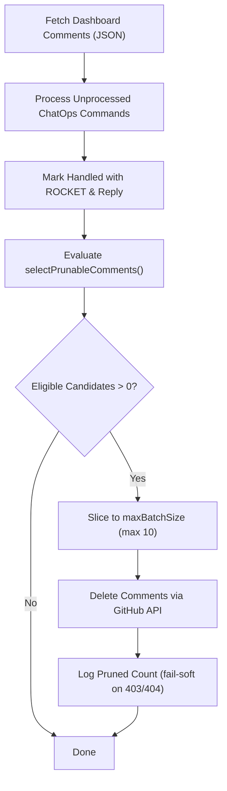

# Dashboard Comment Pruning & Retention — Design Plan

## 1. Problem

Today, the Master Dashboard Issue (`#1`) accumulates every ChatOps command (`/pause`, `/resume`, `/tick`, `/status`, `/directive`, `/retry`, `/revise`, `/ask`, `/setup`, `/add`) and every bot acknowledgment reply (`🚀 Understood...`, `🎯 Directive Applied...`, `⏸️ Orchestrator Paused...`).

Over an active project lifecycle (dozens of tasks, automated hourly ticks, frequent operator steering), comments quickly count into the hundreds.

Observed issues:

| # | Impact | Root Cause | Consequence |
|---|--------|------------|-------------|
| 1 | **API Payload & Pagination Risk** | `gh issue view <num> --json comments` loads all comments into memory | As comments exceed ~100+, GraphQL/REST payloads balloon; GitHub API paginates or truncates responses, risking missed or dropped operator commands. |
| 2 | **Dashboard UI Clutter** | Issue #1 is pinned as the primary project vitrine and live HUD | Operators opening Issue #1 must scroll past hundreds of stale bot acks and ephemeral command outputs to reach current context. |
| 3 | **Console Log Flooding** | `IssueManager.processChatOps` logs every inspected comment | CI/CD logs flood with repetitive `💬 ChatOps considering comment ...` traces for commands that finished days ago. |

---

## 2. Goals / Non-goals

### Goals
- **G1: Maintain Clean Dashboard UI:** Keep the Master Dashboard Issue readable, concise, and focused on current activity (bounding total comments to a small, readable window).
- **G2: Zero Operator Disruption:** An active operator must never see their recent commands or bot replies disappear mid-session (guaranteed minimum retention window).
- **G3: Strict Rate-Limit & API Budgeting:** Pruning must be throttled and batched (max $N$ deletions per cycle) so it never spikes GitHub API consumption.
- **G4: Graceful Permission Fallback:** Deletion failures (e.g. 403 on third-party comments with non-admin tokens) fail soft without interrupting ChatOps or ticks.
- **G5: Idempotency Preservation:** Processed markers (e.g. `ROCKET` reaction) remain respected until actual deletion; deleted comments naturally leave no trace to re-process.

### Non-goals
- **No Pruning of Task Issues:** Individual task issues (`[TASK-XXX]`) and discussion threads remain permanent historical archives until closed.
- **No Deletion of In-Flight / Unprocessed Commands:** Any comment without a `ROCKET` or processing marker is strictly immune.
- **No External Database Dependency:** No separate database or Redis cache needed; GitHub comment metadata (`createdAt`, `reactions`, `author`) provides all required state.

---

## 3. Design

### 3.1 Eligibility & Retention Rules (Pure, Deterministic)

A comment on the Master Dashboard Issue is eligible for deletion if and only if **ALL** of the following conditions are satisfied:

```ts
export interface PrunableComment {
  id: string | number;
  databaseId?: number;
  author: { login: string };
  body: string;
  createdAt: string;
  isBot: boolean;
  hasRocketReaction: boolean;
}

export interface PruneCandidatesOptions {
  now?: Date;
  retentionHours?: number; // default: 2 hours
  keepRecentCount?: number; // default: 10 comments
  maxBatchSize?: number; // default: 10 deletes per cycle
}

export function selectPrunableComments(
  comments: PrunableComment[],
  opts?: PruneCandidatesOptions
): PrunableComment[]
```

#### Rule Matrix:

| Condition | Threshold / Rule | Rationale |
|---|---|---|
| **Issue Scope** | Issue #1 (Dashboard) only | Task issues and discussions preserve historical audit trails. |
| **Trailing Immunity** | Last $K$ comments (default: 10) are strictly immune | Operators actively reading recent conversation or command feedback will never see it vanish. |
| **Age Retention** | Older than $T$ hours (default: 2 hours) | Prevents instant deletion. Gives humans ample time to see bot acks even if traffic is low. |
| **Processing State** | Operator commands: MUST have `ROCKET` reaction. Bot messages: MUST be an automated ack/reply. | Never delete an unprocessed, unacknowledged, or pending command. |
| **Batch Cap** | Maximum $M$ deletions per cycle (default: 10) | Prevents burst API rate-limit exhaustion if a backlog exists. |

---

### 3.2 Execution Flow

Pruning runs as a trailing maintenance step at the conclusion of `IssueManager.processChatOps()`:



1. **Query:** `comments` array is already retrieved during `processChatOps()`. No extra network query needed to fetch comments.
2. **Filter:** `selectPrunableComments()` filters the candidate list purely in-memory.
3. **Delete Action:**
   ```ts
   // REST endpoint (or GraphQL deleteIssueComment):
   DELETE /repos/:owner/:repo/issues/comments/:comment_id
   ```
4. **Error Handling:**
   - `404 Not Found`: Comment was already removed; ignore and continue.
   - `403 Forbidden`: Token does not have permission to delete this user's comment (e.g. non-bot collaborator comment with restricted token); log single warning and skip gracefully.
   - Network / 5xx: Abort remaining deletes for this cycle; retry next cycle.

---

### 3.3 Audit Trail Preservation

Operators do not lose critical accountability or operational history when dashboard comments are pruned:
- **Directives:** Injected directives are persisted into `task.reviewNotes` and embedded into git task commits.
- **State Changes:** Global status changes (`PAUSED`, `IN_PROGRESS`) and `/revise` additions are committed to git on the data/content repo (`state/roadmap.json` and `state/PROGRESS.md`).
- **Dashboard Summary:** The Dashboard issue body is continuously edited in-place with the latest global status, task counts, active runs, and milestone breakdown.

---

### 3.4 Configurable Parameters

Exposed in `orchestrator/config.ts` with sensible defaults:

```ts
CHATOPS_PRUNE_ENABLED: process.env.CHATOPS_PRUNE_ENABLED !== "false", // default: true
CHATOPS_PRUNE_RETENTION_HOURS: parseInt(process.env.CHATOPS_PRUNE_RETENTION_HOURS || "2", 10), // 2h retention
CHATOPS_PRUNE_KEEP_RECENT: parseInt(process.env.CHATOPS_PRUNE_KEEP_RECENT || "10", 10), // keep last 10
CHATOPS_PRUNE_BATCH_LIMIT: parseInt(process.env.CHATOPS_PRUNE_BATCH_LIMIT || "10", 10), // max 10 per tick
```

---

## 4. Acceptance Criteria

- **AC1: Retention Immune Window:** Given a list of 15 comments where all 15 are older than 24h and processed, `selectPrunableComments` returns at most 5 comments, leaving the latest 10 completely untouched.
- **AC2: Minimum Age Guard:** Given a comment processed with `ROCKET` 15 minutes ago, it is NEVER selected for pruning, regardless of total comment count.
- **AC3: Unprocessed Guard:** Given an operator comment without a `ROCKET` reaction (even if 48h old), it is NEVER selected for pruning.
- **AC4: Batch Limit:** Given 100 eligible prunable comments, the function returns at most `maxBatchSize` (default: 10) in a single run.
- **AC5: Fail-Soft Permission Handling:** When the GitHub API returns HTTP 403 on a delete attempt, the error is caught, logged once, and execution finishes successfully with exit code 0.
- **AC6: Bot vs User Classification:** Bot acknowledgment comments associated with pruned or processed commands are cleaned up alongside or after the command.

---

## 5. Rollout Plan

1. **Step 1:** Implement pure `selectPrunableComments` in `orchestrator/issue_manager.ts`.
2. **Step 2:** Add unit tests in `tests/issue_manager.test.ts` verifying AC1–AC4, edge cases (empty comments, exact boundary timestamps, missing author).
3. **Step 3:** Wire deletion execution into `IssueManager.pruneDashboardComments` and call it at the end of `processChatOps`.
4. **Step 4:** Validate against live repository with dry-run/real run in CI.

---

## 6. Risks & Mitigations

| Risk | Impact | Mitigation |
|---|---|---|
| **Accidental Deletion of Pending Command** | Operator command lost before bot reads it | Strict prerequisite: comment must have `ROCKET` or be a recognized bot reply. Unreacted comments are never pruned. |
| **Operator Confusion ("Where did my comment go?")** | Operator thinks command failed | Double protection: (a) Trailing 10 comments are strictly immune; (b) Minimum 2-hour age floor ensures humans see acknowledgment before cleanup. |
| **API Rate-Limit Spike** | Exceeding GitHub REST rate limit during cleanup | Paced batching (`MAX_BATCH_SIZE = 10` per tick). A backlog of 100 comments clears smoothly across 10 ticks with zero rate spikes. |
| **Insufficient Delete Permissions** | Workflow crashes if PAT/token cannot delete collaborator comments | Wrap comment deletion in try/catch; inspect status code; 403 logs soft warning and skips without throwing. |
