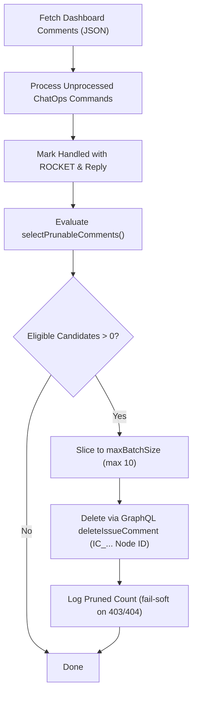

# Dashboard Comment Pruning & Retention — Design Plan

## 1. Problem

Today, the Master Dashboard Issue (`#1`) accumulates every ChatOps command (`/pause`, `/resume`, `/tick`, `/status`, `/directive`, `/retry`, `/revise`, `/ask`, `/setup`, `/add`) and every bot acknowledgment reply (`🚀 Understood...`, `🎯 Directive Applied...`, `⏸️ Orchestrator Paused...`).

Over an active project lifecycle (dozens of tasks, automated hourly ticks, frequent operator steering), comments quickly count into the hundreds.

Observed issues:

| # | Impact | Root Cause | Consequence |
|---|--------|------------|-------------|
| 1 | **Bloated API Payload Size** | `gh issue view <num> --json comments` loads all comments into memory | As comments exceed ~100+, the JSON payload balloons on every single tick/ChatOps run; parsing megabytes of comment trees slows execution and burns runner memory. |
| 2 | **Dashboard UI Clutter** | Issue #1 is pinned as the primary project vitrine and live HUD | Operators opening Issue #1 must scroll past hundreds of stale bot acks and ephemeral command outputs to reach current context. |
| 3 | **Console Log Flooding** | `IssueManager.processChatOps` logs every inspected comment | CI/CD logs flood with repetitive `💬 ChatOps considering comment ...` traces for commands that finished days ago. |

---

## 2. Goals / Non-goals

### Goals
- **G1: Maintain Clean Dashboard UI:** Keep the Master Dashboard Issue readable, concise, and focused on current activity (bounding total comments to a small, readable window).
- **G2: Zero Information Loss:** High-value single-copy bot responses (`/ask` answers, `/status` reports, `/log` dumps, `/setup` audits, escalation notices) are **never pruned**. Only ephemeral acks and processed commands are eligible.
- **G3: Zero Operator Disruption:** An active operator must never see their recent commands or bot replies disappear mid-session (guaranteed minimum retention window).
- **G4: Native GraphQL Deletion (Zero Extra Queries):** Prune directly using GraphQL Node IDs (`IC_...`) returned by `gh issue view` via `deleteIssueComment`. Never attempt dead REST numeric-ID paths.
- **G5: Strict Rate-Limit & API Budgeting:** Pruning must be throttled and batched (max $N$ deletions per cycle) so it never spikes GitHub API consumption.
- **G6: Graceful Permission Fallback:** Deletion failures (e.g. 403 on third-party comments with non-admin tokens) fail soft without interrupting ChatOps or ticks.
- **G7: Idempotency Preservation:** Processed markers (`ROCKET` reaction) remain respected until actual deletion; deleted comments naturally leave no trace to re-process.

### Non-goals
- **No Pruning of Task Issues:** Individual task issues (`[TASK-XXX]`) and discussion threads remain permanent historical archives until closed.
- **No Deletion of In-Flight / Unprocessed Commands:** Any comment without a `ROCKET` processing marker is strictly immune.
- **No Deletion of Unique Information:** Reports and answers that live only in the comment thread are strictly exempt.

---

## 3. Design

### 3.1 Bot Message Classification (Disposable Acks vs High-Value Content)

A bot comment is **NOT automatically junk**. Bot comments fall into two distinct categories:

```ts
/**
 * Disposable bot messages: ephemeral notifications, operational acknowledgments,
 * and syntax guidance. Safe to prune once past retention.
 * Patterns below are anchored to the exact ack formats in
 * orchestrator/issue_manager.ts + engine.ts (verified, not from memory):
 * a non-matching ack degrades to KEPT (fail-closed), so a stale pattern
 * silently stops pruning instead of deleting wrongly.
 */
const DISPOSABLE_BOT_PATTERNS: RegExp[] = [
  /⏸️\s*\*\*Orchestrator Paused:\*\*/,
  /▶️\s*\*\*Orchestrator Resumed:\*\*/,
  /🔔\s*\*\*Tick [Rr]equested:\*\*/, // live format uses lowercase "requested"
  /🎯\s*\*\*Directive Applied to/,
  /🔁\s*\*\*Revision \[/, // live: "Revision [TASK-X] queued", not "Revision Queued for"
  /➕\s*\*\*Task \[.+?\] queued as PENDING/, // highest-volume ack (/add)
  /🔄\s*\*\*Task \[.+?\] Re-queued:/, // (/retry)
  /❓\s*Unknown command/,
  /🔤\s*Understood\s+`\/[a-z]+`/,
  /⚠️\s*(?:Usage:|Task Not Found|\*\*Task Not Found:\*\*|\*\*Tick dispatch failed:\*\*)/,
  /💬\s*\*\*Relayed to \[/, // live: "Relayed to [TASK-X] discussion", not "Relayed message to"
  /\[FIX-ROUND:/,
  /⚠️\s*Discussions unavailable/,
];

/**
 * High-value bot messages: single-copy information, audits, or status reports
 * that exist nowhere else. MUST NEVER BE PRUNED. Checked FIRST: anything
 * matching here survives even if a disposable pattern would also match.
 */
const HIGH_VALUE_BOT_PATTERNS: RegExp[] = [
  /❓\s*\*\*Answer:\*\*/,           // /ask single-copy answer
  /📊\s*\*\*Current Status Report:\*\*/, // /status snapshot
  /📜\s*\*\*Recent Logs for/,       // /log output
  /🔧\s*\*\*Setup Report/,          // /setup audit
  /🚨\s*\*\*(?:Needs a human|Launch verification needs a human)/, // escalations (both word orders)
  /🎉\s*\*\*All tasks have been successfully completed/, // finale (the only dashboard celebration format)
  /🌅\s*\*\*Auto-resurrect #/,      // resuscitation record (low volume, keep)
];
```

### 3.2 Eligibility & Retention Rules (Pure, Deterministic)

A comment on the Master Dashboard Issue is eligible for deletion if and only if **ALL** of the following conditions are satisfied:

```ts
export interface PrunableComment {
  id: string; // GraphQL Node ID ("IC_kw...")
  author: { login: string };
  body: string;
  createdAt: string;
  isBot: boolean;
  hasRocketReaction: boolean;
}

export interface PruneCandidatesOptions {
  now?: Date;
  retentionHours?: number; // default: 2 hours
  keepRecentCount?: number; // default: 10 comments
  maxBatchSize?: number; // default: 10 deletes per cycle
}

export function isDisposableComment(comment: PrunableComment): boolean {
  if (comment.isBot) {
    if (HIGH_VALUE_BOT_PATTERNS.some((rx) => rx.test(comment.body))) return false;
    return DISPOSABLE_BOT_PATTERNS.some((rx) => rx.test(comment.body));
  }
  // User comments: only prunable if acknowledged & processed by the bot (ROCKET)
  return comment.hasRocketReaction;
}

export function selectPrunableComments(
  comments: PrunableComment[],
  opts?: PruneCandidatesOptions
): PrunableComment[]
```

#### Rule Matrix:

| Condition | Threshold / Rule | Rationale |
|---|---|---|
| **Issue Scope** | Issue #1 (Dashboard) only | Task issues and discussions preserve historical audit trails. |
| **Trailing Immunity** | Last $K$ comments (default: 10) are strictly immune | Operators actively reading recent conversation or command feedback will never see it vanish. |
| **Age Retention** | Older than $T$ hours (default: 2 hours) | Prevents instant deletion. Gives humans ample time to see bot acks even if traffic is low. |
| **Content Classification** | HIGH_VALUE checked FIRST for every author (bot identity comes in shapes no login regex covers); then Bot needs DISPOSABLE match, User needs `ROCKET`. | Never delete single-copy content (/ask, /status) or unprocessed commands. |
| **Batch Cap** | Maximum $M$ deletions per cycle (default: 10) | Prevents burst API rate-limit exhaustion if a backlog exists. |

---

### 3.3 Execution Flow: GraphQL Mutation

Pruning runs as a trailing maintenance step at the conclusion of `IssueManager.processChatOps()`:



#### Deletion Mechanism (GraphQL Native):
Because `gh issue view --json comments` returns GraphQL Node IDs (`id: "IC_kw..."`) and numeric `databaseId` is null/omitted in GitHub CLI issue view output, deletion **must** use GraphQL directly:

```ts
const mutation = `
  mutation($id: ID!) {
    deleteIssueComment(input: { id: $id }) {
      clientMutationId
    }
  }
`;

await GitManager.run([
  "gh", "api", "graphql",
  "-F", `id=${comment.id}`,
  "-f", `query=${mutation}`
]);
```

- **Zero extra queries:** No lookup needed to translate Node ID into a REST database ID.
- **Fail-soft:**
  - `404 / NOT_FOUND`: Comment was already removed; ignore and continue.
  - `403 / FORBIDDEN`: Token does not have permission to delete collaborator comment; log warning once, skip gracefully.
  - Network / 5xx: Abort remaining deletes for this cycle; retry next cycle.

---

### 3.4 Audit Trail Preservation

Operators do not lose critical accountability or operational history when dashboard comments are pruned:
- **Directives:** Injected directives are persisted into `task.reviewNotes` and embedded into git task commits.
- **State Changes:** Global status changes (`PAUSED`, `IN_PROGRESS`) and `/revise` additions are committed to git on the data/content repo (`state/roadmap.json` and `state/PROGRESS.md`).
- **Dashboard Summary:** The Dashboard issue body is continuously edited in-place with the latest global status, task counts, active runs, and milestone breakdown.

---

### 3.5 Configurable Parameters

Exposed in `orchestrator/config.ts` using the repository's `safeInt` pattern:

```ts
CHATOPS_PRUNE_ENABLED: process.env.CHATOPS_PRUNE_ENABLED !== "false", // default: true
CHATOPS_PRUNE_RETENTION_HOURS: safeInt(process.env.CHATOPS_PRUNE_RETENTION_HOURS, 2), // 2h retention
CHATOPS_PRUNE_KEEP_RECENT: safeInt(process.env.CHATOPS_PRUNE_KEEP_RECENT, 10), // keep last 10
CHATOPS_PRUNE_BATCH_LIMIT: safeInt(process.env.CHATOPS_PRUNE_BATCH_LIMIT, 10), // max 10 per tick
```

---

## 4. Acceptance Criteria

- **AC1: Retention Immune Window:** Given a list of 15 comments where all 15 are older than 24h and disposable, `selectPrunableComments` returns at most 5 comments, leaving the latest 10 completely untouched.
- **AC2: High-Value Content Immunity:** Bot responses containing `/ask` answers (`❓ **Answer:**`), `/status` snapshots, `/log` dumps, or escalation alerts are NEVER selected for pruning, regardless of age.
- **AC3: Minimum Age Guard:** Given a disposable comment processed 15 minutes ago, it is NEVER selected for pruning, regardless of total comment count.
- **AC4: Unprocessed Guard:** Given an operator command without a `ROCKET` reaction (even if 48h old), it is NEVER selected for pruning.
- **AC5: Batch Limit:** Given 100 eligible prunable comments, the function returns at most `maxBatchSize` (default: 10) in a single run.
- **AC6: GraphQL ID Parity:** The deletion executes via GraphQL `deleteIssueComment` passing the exact `IC_...` Node ID without requiring REST conversion.
- **AC7: Fail-Soft Permission Handling:** When the GitHub API returns an authorization error on a delete attempt, the error is caught, logged once, and execution finishes successfully with exit code 0.

---

## 5. Rollout Plan

1. **Step 1:** Implement pure `isDisposableComment` and `selectPrunableComments` in `orchestrator/issue_manager.ts`.
2. **Step 2:** Add unit tests in `tests/issue_manager.test.ts` verifying AC1–AC5 (testing high-value immunity, trailing window, age floor, unprocessed immunity).
3. **Step 3:** Wire GraphQL deletion execution into `IssueManager.pruneDashboardComments` and call it at the end of `processChatOps`.
4. **Step 4:** Validate against live repository with dry-run/real run in CI.

---

## 6. Risks & Mitigations

| Risk | Impact | Mitigation |
|---|---|---|
| **Loss of Single-Copy Data** | Useful `/ask` or `/status` output erased | Strict allowlist: only disposable acks are prunable; high-value answers match an explicit denylist and are preserved forever (AC2). |
| **Accidental Deletion of Pending Command** | Operator command lost before bot reads it | Strict prerequisite: comment must have `ROCKET` or match disposable bot ack. Unreacted comments are never pruned. |
| **Operator Confusion ("Where did my command go?")** | Operator thinks command failed | Double protection: (a) Trailing 10 comments are strictly immune; (b) Minimum 2-hour age floor ensures humans see acknowledgment before cleanup. |
| **REST ID Lookup Incompatibility** | Deletion fails due to missing numeric ID | Primary mechanism is GraphQL `deleteIssueComment` using the native `IC_...` Node ID already present in memory. |
| **API Rate-Limit Spike** | Exceeding GitHub GraphQL rate limit during cleanup | Paced batching (`MAX_BATCH_SIZE = 10` per tick). A backlog of 100 comments clears smoothly across 10 ticks with zero rate spikes. |
| **Insufficient Delete Permissions** | Workflow crashes if PAT/token cannot delete collaborator comments | Wrap comment deletion in try/catch; inspect error; GraphQL permission errors log a soft warning and skip without throwing. |
